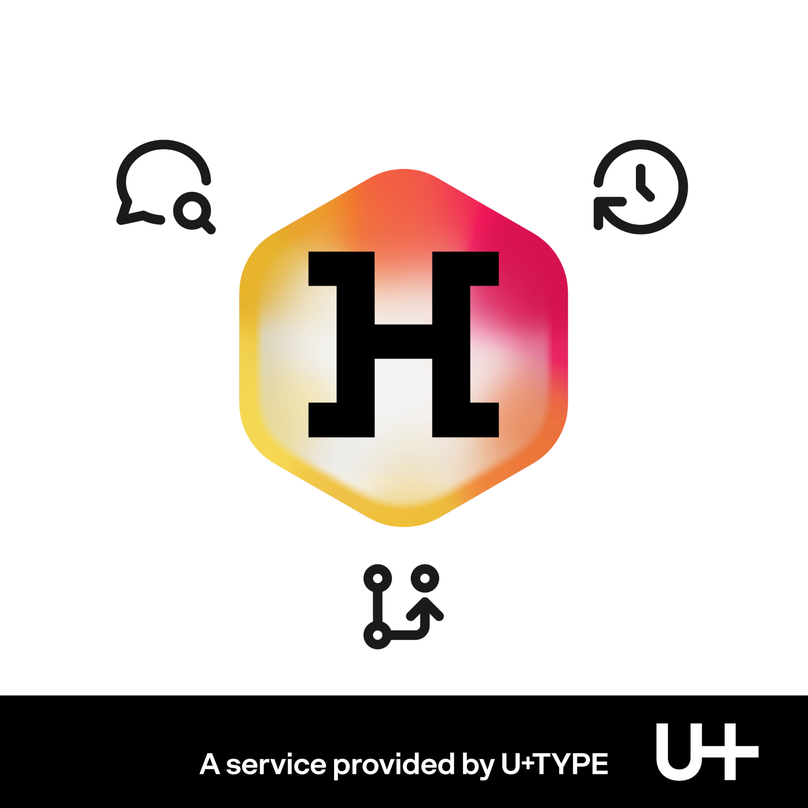

This is a guest blog post by [Jérémie Hornus](https://uplustype.com/).

Hello Fontra Blog readers, Jérémie writing here; I realise that I never wrote any post here despite my ever-strong bonds with Fontra. I was there at its embryonic stage of development when it sprouted from the RoboCJK RoboFont extension and the .rcjk format I had put together 7 years ago, back in 2019! Then Just van Rossum came over and has been developing Fontra ever since.

We had the need for an efficient and accurate way of designing CJK fonts (Han script) that requires: 1. A team of several designers working simultaneously on the same file, and 2. a way to shape glyphs that feature highly variable but repeated elements, and software able to handle several thousand glyphs at once in a single file.

Today I am proud to announce Fontra Hive: a web platform hosting Fontra. For the first time you can try Fontra without downloading anything, simply go to [try.fontrahive.com](https://try.fontrahive.com) and you can create typefaces from scratch, open Glyphs files, UFOs and Designspaces; it is even possible to compile test TTFs directly in the browser (thanks to fontc).

So what does Hive add? We are proposing change history at glyph level, every change is recorded and you can go back in time, group a bunch of changes into a named 'snapshot', even create branches (for testing apart) and merge possibly back into the main branch. Moreover one can drop comments and doodle notes directly on the glyph area, that can start a discussion thread, with several detailed features (assigning, labeling…). In addition for more advanced projects the font engineer team can have the buildable into a proper GitHub repo and have it linked to the designer's project in Fontra Hive: synching them is possible by the persons in charge. Finally Observers and Reviewers can be added for free to any project. All data stays hosted in Europe.

Fontra Hive starts with a free limited account, and is 9€ (excl. VAT) monthly for a full Solo account; there is also a free 21-day period for every new account, which opens the week of Monday 19 October 2026. Hive is a payable service since hosting and maintaining such a service online has a cost. However the plug-in itself is still Open Source GPLv3. Fontra embedded in Hive is exactly the same version as the publicly available one, and it is updated on a regular basis. Fontra Hive is an independent product and service provided by U+TYPE.

Try it in the browser: [try.fontrahive.com](https://try.fontrahive.com) and open your account: [fontrahive.com](https://fontrahive.com)

